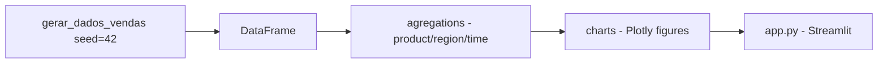

# dashboard-vendas-streamlit

**English** · [Português (Brasil)](README.md)

[](#) [](#) [](#) [](#) [](#) [](LICENSE)

## What it is

**A Streamlit sales dashboard**: it generates a **synthetic, deterministic** sales dataset (seed 42), aggregates by **product**, **region** and **time**, and displays **Plotly** charts in a **Streamlit** app. It is an educational data-visualisation lab.

## Status

An educational lab, working and tested (12 tests — aggregations and charts).

## Features

- **Data** (`data.py`): `gerar_dados_vendas(seed=42, num_vendas=...)` — a deterministic synthetic dataset.
- **Aggregations** (`agregacoes.py`): `agregar_por_produto`, `agregar_por_regiao`, `agregar_por_tempo`.
- **Charts** (`charts.py`): `fig_vendas_por_produto/regiao/tempo` — Plotly figures ready for the app.
- **App** (`app.py`): assembles the Streamlit dashboard with the three charts.

## Architecture

A `dashboard_vendas` package with pure layers (`agregacoes`, `charts`, `data`) that are testable, and the Streamlit `app.py` consuming them.



## Stack

- Python ≥ 3.10
- Streamlit ≥ 1.40, Plotly ≥ 5.0, pandas ≥ 2.0
- pytest (dev)

## Repository layout

```
dashboard-vendas-streamlit/
├── pyproject.toml · BRIEF.md
├── src/dashboard_vendas/
│   ├── data.py        # synthetic dataset (seeded)
│   ├── agregacoes.py  # product/region/time
│   └── charts.py      # Plotly figures
├── app.py             # Streamlit app
├── tests/             # 12 tests
└── LICENSE            # MIT
```

## Prerequisites and installation

```bash
pip install -e .
```

## How to run

```bash
streamlit run app.py
# opens the dashboard in the browser
```

## Tests and quality

Real command (verified by the agent):

```bash
PYTHONPATH=src python -m pytest tests/
# 12 passed
```

## Technical decisions and trade-offs

- **Aggregations and charts as pure functions**: testable without opening the app; Streamlit is only the presentation layer.
- **Seeded synthetic dataset**: reproducible demos without real data.

## Known limitations and roadmap

- No connection to a real sales source (CSV/database) — generated data only.
- Read-only dashboard: no advanced filters or drill-down.

## Development process

An individual project by Kelvin Oliveira, built with orchestrated AI agents and reviewed by the author.

## License and author

MIT — Copyright (c) 2026 Kelvin Rebelo de Oliveira. Author: [Kelvin Oliveira](https://github.com/KelvinOliveiraCode) · [Portfolio](https://kelvinoliveiracode.github.io/portfolio/)
