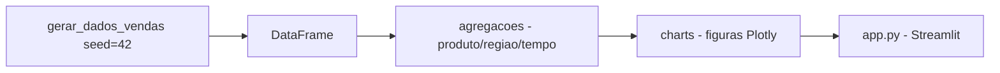

# dashboard-vendas-streamlit

[English](README.en.md) · **Português (Brasil)**

[](#) [](#) [](#) [](#) [](#) [](LICENSE)

## O que é

**Dashboard de vendas em Streamlit**: gera um dataset de vendas **sintético e determinístico** (seed 42), agrega por **produto**, **região** e **tempo**, e exibe gráficos **Plotly** num app **Streamlit**. É um laboratório educacional de visualização de dados.

## Status

Laboratório educacional funcional e testado (12 testes — agregações e gráficos).

## Funcionalidades

- **Dados** (`data.py`): `gerar_dados_vendas(seed=42, num_vendas=...)` — dataset sintético determinístico.
- **Agregações** (`agregacoes.py`): `agregar_por_produto`, `agregar_por_regiao`, `agregar_por_tempo`.
- **Gráficos** (`charts.py`): `fig_vendas_por_produto/regiao/tempo` — figuras Plotly prontas para o app.
- **App** (`app.py`): monta o dashboard Streamlit com os três gráficos.

## Arquitetura

Pacote `dashboard_vendas` com camadas puras (`agregacoes`, `charts`, `data`) testáveis, e o `app.py` do Streamlit consumindo tudo.



## Stack

- Python ≥ 3.10
- Streamlit ≥ 1.40, Plotly ≥ 5.0, pandas ≥ 2.0
- pytest (dev)

## Estrutura do repositório

```
dashboard-vendas-streamlit/
├── pyproject.toml · BRIEF.md
├── src/dashboard_vendas/
│   ├── data.py        # dataset sintético (seed)
│   ├── agregacoes.py  # produto/região/tempo
│   └── charts.py      # figuras Plotly
├── app.py             # app Streamlit
├── tests/             # 12 testes
└── LICENSE            # MIT
```

## Pré-requisitos e instalação

```bash
pip install -e .
```

## Como executar

```bash
streamlit run app.py
# abre o dashboard no navegador
```

## Testes e qualidade

Comando real (verificado pelo agente):

```bash
PYTHONPATH=src python -m pytest tests/
# 12 passed
```

## Decisões técnicas e trade-offs

- **Agregações e gráficos como funções puras**: testáveis sem abrir o app; o Streamlit só faz a camada de apresentação.
- **Dataset sintético com seed**: demos reprodutíveis sem dados reais.

## Limitações conhecidas e roadmap

- Sem conexão com fonte real de vendas (CSV/banco) — só dados gerados.
- Dashboard de leitura: sem filtros avançados ou drill-down.

## Processo de desenvolvimento

Projeto individual de Kelvin Oliveira, construído com agentes de IA orquestrados e revisado pelo autor.

## Licença e autor

MIT — Copyright (c) 2026 Kelvin Rebelo de Oliveira. Autor: [Kelvin Oliveira](https://github.com/KelvinOliveiraCode) · [Portfólio](https://kelvinoliveiracode.github.io/portfolio/)
